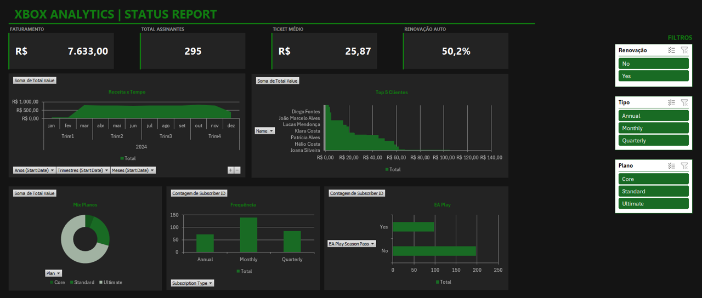

<a id="top"></a>

<div align="center">


<h1>Xbox Sales Dashboard</h1>

<p>
  <strong>Excel VBA macro that builds a one-page sales dashboard from raw data with one click.</strong><br />
  <sub>Slicers, KPI cards and charts in an Xbox Series X dark theme</sub>
</p>

<p>
  <a href="https://voaneves.github.io/xbox-sales/"><picture><source media="(prefers-color-scheme: dark)" srcset="https://raw.githubusercontent.com/voaneves/xbox-sales/main/assets/buttons/landing-dark.svg" /></picture></a>
  <a href="https://github.com/voaneves/xbox-sales/raw/main/xbox_sales.xlsm"><picture><source media="(prefers-color-scheme: dark)" srcset="https://raw.githubusercontent.com/voaneves/xbox-sales/main/assets/buttons/workbook-dark.svg" /></picture></a>
</p>

<p><sub>Need something like this? <a href="https://voaneves.com/en/#contact"><strong>Let's talk →</strong></a></sub></p>

<p>
  <a href="https://github.com/voaneves/xbox-sales/blob/main/LICENSE"></a>
  
  <a href="https://github.com/voaneves/xbox-sales/issues"></a>
</p>

<p>
  <a href="#about-the-project">About</a> ·
  <a href="#getting-started">Getting started</a> ·
  <a href="#methodology">Methodology</a> ·
  <a href="#challenges-and-solutions">Challenges</a> ·
  <a href="#results">Results</a> ·
  <a href="#contact">Contact</a>
</p>

</div>

<picture>
  <source media="(prefers-color-scheme: dark)" srcset="https://raw.githubusercontent.com/voaneves/xbox-sales/main/assets/brand/rule-dark.svg" />
  <source media="(prefers-color-scheme: light)" srcset="https://raw.githubusercontent.com/voaneves/xbox-sales/main/assets/brand/rule-light.svg" />
  
</picture>

## About the project

Run one macro in Excel and get an executive sales dashboard built from your raw data, on a single page and in about three seconds.

<p align="center">
  <a href="https://voaneves.github.io/xbox-sales/">
    
  </a>
</p>

The challenge is to transform raw CSV data into a "One Page" executive report with a single click, ensuring data integrity and a high-end visual experience based on the **Xbox Series X** design language (dark mode and neon green).

Key points:

- **Fail-safe engine:** a hidden calculation sheet that prevents `#REF!` errors.
- **Ghostbuster system:** automatic cleanup of previous dashboard instances.
- **Dynamic slicers:** sidebar filters that control all visuals simultaneously.
- **One-page view:** auto-zoom to 85% to fit the screen without scrolling.

### Technologies used

- **Microsoft Excel:** the interface and calculation engine.
- **VBA (Visual Basic for Applications):** ETL automation, chart generation and UI construction.
- **Pivot tables (cache):** high-performance data aggregation.

## Getting started

1. Download [`xbox_sales.xlsm`](https://github.com/voaneves/xbox-sales/raw/main/xbox_sales.xlsm) and open it in Excel. Enable macros when asked: the VBA code is embedded in the workbook.
2. Keep your data on the sheet named `Bases`.
3. Press `Alt + F11` to open the VBA editor, choose the dashboard macro and press `F5` to run it.
4. The dashboard is generated in a new sheet.

## Project structure

```
xbox_sales.xlsm   Workbook with the data and the embedded VBA macros
img/              Logo and dashboard screenshot
assets/           README buttons, logo variants and brand marks
landing/          Static landing page (deployed to GitHub Pages)
LICENSE
README.md
```

## Methodology

### Data preparation (ETL)

**Sanitization:** the script automatically detects the data sheet (even with naming bugs like `B̳ases`), converts text-stored dates into real Date objects, and forces currency columns to numeric types to avoid aggregation errors.

### The "hidden engine" concept

1. **Engine_Oculta:** instead of linking charts directly to raw data, the script creates a hidden sheet (`xlSheetVeryHidden`) containing specific pivot tables.
2. **Static mapping:** key performance indicators (KPIs) are mapped to fixed cells using `GETPIVOTDATA` formulas generated by VBA. This ensures the visual cards never break, even if the data structure changes.

### UI and UX design

3. **Visual identity:** RGB(20, 20, 20) for the background (true dark mode) and RGB(16, 124, 16) for accents (Xbox green).
4. **Grid system:** charts are generated with precise `Top`, `Left`, `Width` and `Height` coordinates to form a perfect grid.

### Interactivity

5. **Slicers loop:** a loop iterates through all generated pivot tables to connect them to the slicers (Plan, Renewal, Type), creating a unified filtering experience.

## Challenges and solutions

### Challenge 1: the "Name Already Taken" error

- **Problem:** running the macro multiple times crashed the script because sheets named "Dashboard_Xbox" already existed.
- **Solution:** the **Ghostbuster** routine. A loop checks for existing sheets (visible or hidden), forces them to be visible, and deletes them before generating new ones.

### Challenge 2: date clutter on charts

- **Problem:** the raw dataset contained daily records, making the area chart unreadable (hundreds of points).
- **Solution:** the `.Group` method on the PivotField groups dates by **months and years**, creating a smooth trendline.

### Challenge 3: error 1004 on filtering

- **Problem:** filtering "Top 5 Clients" failed because the value field name changed with the Excel language (for example "Sum of" vs "Soma de").
- **Solution:** a dynamic reference, `ptTop.DataFields(1).Name`, targets the value field regardless of its display name.

### Challenge 4: broken cards (#REF!)

- **Problem:** when slicers filtered data to zero, standard cell references returned errors.
- **Solution:** direct links were replaced with `IFERROR(GETPIVOTDATA(...), 0)` formulas injected by VBA.

## Results

1. **Efficiency:** report generation time went from about 20 minutes (manual) to **3 seconds**.
2. **Reliability:** the fail-safe engine builds the dashboard even when data quality is less than perfect.
3. **Usability:** the layout is optimized for at-a-glance reading, with the key KPIs at the top and filters on the right.

## To do

- [ ] Add an "Export to PDF" button directly on the dashboard.
- [ ] Create a userform for custom date range selection before generation.

## Reporting bugs

1. Check whether the bug is already in [Issues](https://github.com/voaneves/xbox-sales/issues).
2. If not, open a new issue with a clear title and the steps to reproduce it.
3. If possible, include screenshots (like the error 1004 dialog) or the dataset line that causes the crash.

Pull requests are welcome.

## Contact

<p>
  <a href="https://voaneves.com/en/#contact"><picture><source media="(prefers-color-scheme: dark)" srcset="https://raw.githubusercontent.com/voaneves/xbox-sales/main/assets/buttons/hire-dark.svg" /></picture></a>
  <a href="https://voaneves.com/en/"><picture><source media="(prefers-color-scheme: dark)" srcset="https://raw.githubusercontent.com/voaneves/xbox-sales/main/assets/buttons/site-dark.svg" /></picture></a>
</p>

<a href="https://linkedin.com/in/voaneves">LinkedIn</a> · <a href="mailto:victorneves478@gmail.com">E-mail</a>


<p align="center">
  
</p>

<p align="center"><sub>Released under the <a href="https://github.com/voaneves/xbox-sales/blob/main/LICENSE">MIT License</a>.</sub></p>

<p align="center"><sub><a href="#top">↑ Back to top</a></sub></p>
